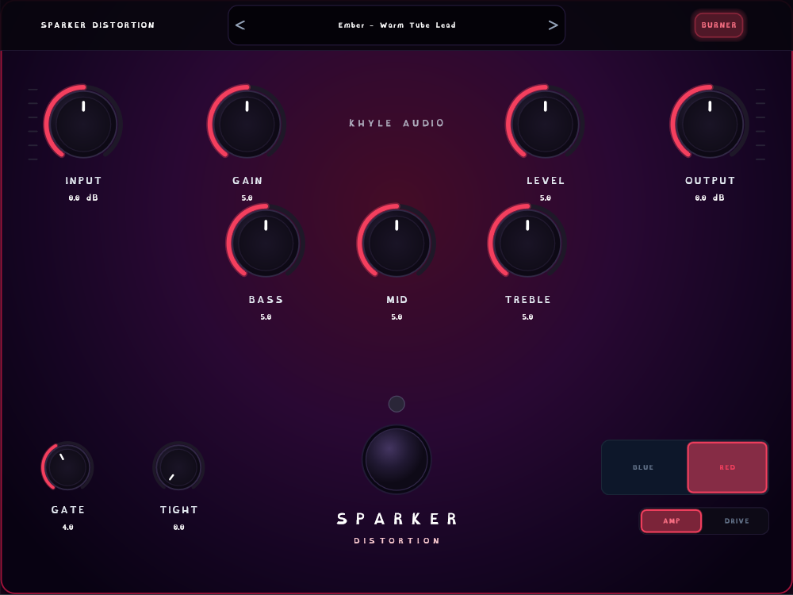

# Sparker Distortion

A circuit-modelled guitar distortion plugin (VST3 + Standalone) built with JUCE.
Three independent circuits in one pedal, each modelled from its own hardware
reference rather than being presets of a shared engine:

| Circuit | Modelled on | Character |
|---|---|---|
| **Ember** | Suhr Riot | Asymmetric diode clipping, three selectable diode voicings |
| **Burner** | REVV G3 | Four-stage cascaded saturation, modern/tight high gain |
| **Blazer** | Friedman BE-OD | Newton–Raphson diode-in-feedback clipper, mid-forward |

Built by Khyle Audio.



*Burner circuit, RED aggression. The UI themes itself to the active circuit.*

## Features

- **Three circuits**, switchable live, each with its own control set, parameter
  tapers and UI theme.
- **AMP / DRIVE global voicing.** `AMP` is the amp-in-a-box voicing — it
  carries the shaping a real amp would otherwise supply (tone-stack mid scoop,
  extra HF rolloff, power-amp sag), for going straight into an IR or FRFR.
  `DRIVE` strips that back out so a real clean amp supplies it instead of it
  being applied twice. The two are level-matched, so toggling is a tonal
  change only.
- **Ember voicing modes** — WARM (germanium, symmetric), CLASSIC (silicon,
  asymmetric), HOT (LED, symmetric).
- **Burner aggression modes** — BLUE / RED.
- Stereo-linked noise gate with hysteresis and hold.
- Per-circuit input/output trim with real signal-peak metering.
- Preset system with factory presets and user preset files.
- Resizable UI (Small / Medium / Large) via right-click.

## DSP notes

The parts that are less obvious than "run a tanh over it":

- **Anti-aliasing is matched to the nonlinearity.** Ember's and Burner's
  saturators use first-order ADAA (antiderivative anti-aliasing) plus 8×/16×
  oversampling. Blazer's clipper is an implicit Newton–Raphson solve with no
  closed-form antiderivative to ADAA with, and it is driven far past its knee,
  so it runs at 32× — measured, that was the single largest aliasing source in
  the plugin (−13.9 dB of non-harmonic energy at 8×, −46.8 dB at 32×).
- **Second-order ADAA was tried and removed.** Its divided difference scales
  as `k³` and loses all float32 precision at realistic drive values; it was
  manufacturing roughly 39 dB of noise. First-order with a drive-scaled
  epsilon is both quieter and cheaper.
- **Power-amp sag** (AMP voicing) is a self-levelling saturator,
  `y = tanh(drive·x/h)·h/drive` with `h = 1 − depth·env/(env+knee)` — unity
  small-signal gain for any `h`, so it compresses without needing makeup.
- **Level matching uses K-weighted (ITU-R BS.1770) loudness**, not RMS of a
  test tone, plus an octave-band balance check. A single scalar is not enough:
  it can be satisfied by a spectral tilt, which is how an early version
  measured "matched" while being audibly weak.

## Building

Requires **CMake ≥ 3.22**, a C++17 compiler, and a local copy of
[JUCE](https://github.com/juce-framework/JUCE) (not vendored here).

```bash
cmake -B build -DJUCE_PATH="C:/JUCE"
cmake --build build --config Release
```

`JUCE_PATH` defaults to `C:/JUCE`; override it as above if yours is elsewhere.

Artifacts land in:

```
build/SuhrRiot_artefacts/Release/VST3/Sparker Distortion.vst3
build/SuhrRiot_artefacts/Release/Standalone/Sparker Distortion.exe
```

To install the VST3, copy the `.vst3` bundle into your system VST3 folder
(on Windows, `C:\Program Files\Common Files\VST3\`).

## Tests

The DSP has an offline measurement suite — it does not just check that the
code runs, it measures harmonic content, aliasing, signal-to-noise, loudness
and octave-band balance, and fails on regressions:

```bash
cmake --build build --target SuhrRiotOfflineTests --config Release
./build/SuhrRiotOfflineTests_artefacts/Release/SuhrRiotOfflineTests.exe
```

## Repository layout

```
Source/dsp/        per-circuit DSP (Ember, Burner, Blazer + shared stages)
Source/gui/        look-and-feel, switches, meters, header, presets
Source/            PluginProcessor / PluginEditor, parameter ranges
Tests/             offline measurement suite
Assets/Fonts/      embedded UI fonts
AI Studio/         original React UI mockup the layout was derived from
```

## A note on the circuit references

This plugin was modelled from manufacturer schematics and service
documentation for the Suhr Riot, REVV G3 and Friedman BE-OD. Those documents
are copyrighted by their respective manufacturers and are **not** included in
this repository. Sparker Distortion is an independent emulation and is not
affiliated with, endorsed by, or associated with Suhr, REVV or Friedman. All
product names are trademarks of their respective owners and are used only to
describe what each circuit was modelled from.
